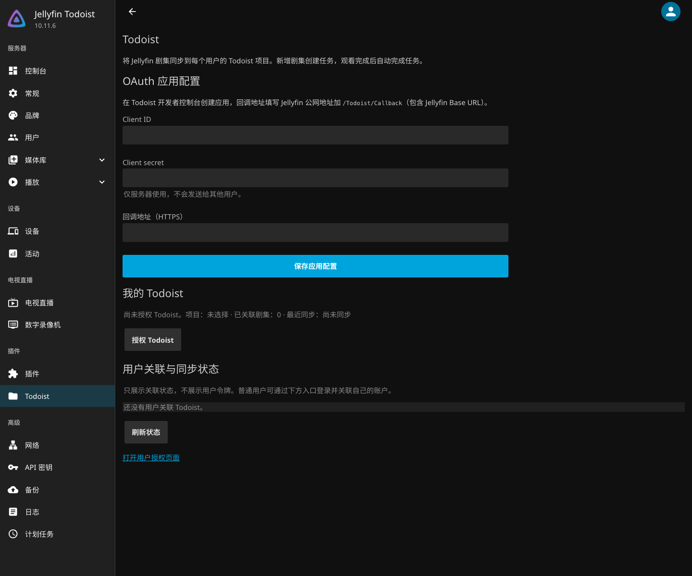

# Jellyfin Todoist 插件

Jellyfin 10.11.x 原生插件，使用 .NET 9。直接监听媒体库、播放停止和已观看状态事件，无需 Webhook 插件、Python 服务或外部数据库。

首次关联项目会为该 Jellyfin 用户可访问的**所有未观看剧集**创建任务，截止日期为今天。建议使用独立的 Todoist 项目。已有 Python SQLite 映射不会自动导入；迁移前停用旧 webhook 和 Python 服务，并使用新项目，避免与旧任务重复。

## 从 Jellyfin 插件仓库安装（推荐）

独立源码项目：[RicterZ/jellyfin-plugin-todoist](https://github.com/RicterZ/jellyfin-plugin-todoist)。

1. 打开 Jellyfin 控制台 → 插件 → 仓库，点击添加。
2. 名称填写 `Todoist`，URL 填写：

   ```text
   https://github.com/RicterZ/jellyfin-plugin-todoist/releases/latest/download/manifest.json
   ```

3. 保存后打开插件目录（Catalog），找到 **Todoist** 并安装。
4. 重启 Jellyfin，在插件列表中打开 Todoist，或通过控制台菜单中的 Todoist 入口进入后台。



后台直接使用 Jellyfin 的 `emby-input`、`emby-select`、`emby-button`、列表和主题，不使用独立的后台样式。支持配置 OAuth 应用、为当前管理员授权和选择项目、手动同步、解除自身关联，以及查看所有用户的关联与错误状态；用户列表仅管理员可见，不暴露令牌。

## 从源码编译和安装

需要 [.NET 9 SDK](https://dotnet.microsoft.com/download/dotnet/9.0)。在仓库根目录运行：

```bash
dotnet build plugins/Jellyfin.Plugin.Todoist -c Release
dotnet run --project plugins/Jellyfin.Plugin.Todoist.Tests -c Release
```

停止 Jellyfin，在 **Jellyfin 的插件目录**下创建 `Todoist_1.0.0.0/`，把以下两个文件放入其中：

- `plugins/Jellyfin.Plugin.Todoist/bin/Release/net9.0/Jellyfin.Plugin.Todoist.dll`
- `plugins/Jellyfin.Plugin.Todoist/meta.json`

例如官方 Docker 部署中的目标目录为 `/config/plugins/Todoist_1.0.0.0/`。原生安装使用 Jellyfin 实际的插件路径，不是本仓库的 `plugins/` 目录。只安装此插件 DLL 和清单，Jellyfin 的程序集由服务器提供。重新启动 Jellyfin，在控制台 → 插件中检查 Todoist 是否加载。

## 管理员配置 OAuth

1. 在 [Todoist 应用管理页面](https://developer.todoist.com/appconsole.html)创建 OAuth 应用。
2. 设置 Redirect URL：你的公网 Jellyfin 地址加 `/Todoist/Callback`。例如 `https://media.example.com/jellyfin/Todoist/Callback`，其中 `/jellyfin` 是可选的 Jellyfin Base URL。
3. 在 Jellyfin 控制台 → 插件 → Todoist 中填入 Client ID、Client secret、完全一致的 Redirect URL 并保存。
4. 对外使用 HTTPS。HTTP 仅允许 localhost 调试。反向代理需要保留 Jellyfin Base URL，并正确转发原始协议，确保 OAuth cookie 正常返回。

OAuth 请求 `data:read_write` 权限，用于读取项目、创建任务和分区、完成任务以及归档分区。Client secret 仅由服务器交换令牌使用。

## 在后台关联当前管理员的项目

在 Todoist 插件后台保存 OAuth 应用配置后，点击 **授权 Todoist**。回调后自动返回 Jellyfin 原生后台，在 **我的 Todoist** 中选择项目并保存。点击 **立即同步** 排队同步，点击 **刷新状态** 查看结果；**用户关联与同步状态** 展示各用户的项目、任务数、最近成功时间和错误。

## 每个用户关联 Todoist 项目

1. 打开 Jellyfin 地址下的 `/Todoist/Account`，例如 `https://media.example.com/jellyfin/Todoist/Account`。管理员也可以从插件配置页点击入口。
2. 使用自己的 Jellyfin 用户名和密码登录。此页面使用独立 Jellyfin 会话，支持普通用户，无需管理员权限。
3. 普通用户点击 **Authorize Todoist**，在 Todoist 确认授权。回调成功后返回账户页。
4. 选择 Todoist 项目 / 看板，点击 **Save project**。同步立即排队执行。
5. 使用 **Refresh status** 查看最近同步时间、任务数和错误；**Sync now** 可手动请求重试。

每个 Jellyfin 用户独立授权，选择自己的项目。播放和“标记已观看”只完成对应用户的任务。接口从已验证的 Jellyfin 会话取用户 ID，不接受其他用户 ID，也不允许使用服务器全局 API key 绑定账户。

普通用户的授权页面复用本服务器安装的 Jellyfin Web CSS 和深色主题。该页面的 Jellyfin 会话令牌只保存在当前标签页的 `sessionStorage`，密码不保存。点击 **Sign out** 会注销该会话。Todoist access token / refresh token 始终保存在服务器，不返回浏览器；OAuth state 有效期 10 分钟、仅用一次，并绑定发起授权的浏览器。服务器重启后需重新发起尚未完成的授权。

## 同步行为

- 剧集按剧名分区；任务标题如 `Series S01E05`，保留特别篇的 `S00`。
- 新增剧集触发同步；启动、项目关联和每两分钟的核对会补齐未观看剧集。
- Jellyfin 报告播放完成，或停止位置与总时长相差不超过 60 秒时，完成对应任务。手动标记“已观看”同样生效。
- 任务映射持久化，重启、同账户重新授权及切换回之前的项目会保留去重记录。写请求使用稳定的 `X-Request-Id`；失败请求在下一轮核对重试。
- 已完成任务的分区为空时自动归档。新增同名剧集时恢复分区。只归档插件跟踪的分区，不处理无关空分区。
- API 列表支持分页，OAuth 应用提供短期令牌时自动刷新并保存轮换后的 refresh token。HTTP 429 / 网络错误会显示在状态页并留待后续同步，不会提前标记成功。
- 换项目不会删除原项目任务；换 Todoist 账户会要求重新选项目。取消关联删除本地授权和映射，保留 Todoist 任务；如需撤销应用权限，在 Todoist 的集成设置中移除授权。取消关联后再次连接属于新同步，应选新项目或先清理原任务。
- 当前只创建和完成剧集任务，不同步电影、删除事件，也不会因取消“已观看”而重新打开已完成任务。

## 数据和排错

OAuth 应用配置保存在 Jellyfin 管理员插件配置中。用户授权与任务映射位于 Jellyfin 数据目录的 `todoist/state.json`，采用临时文件原子替换；Unix 上目录权限 `0700`、文件权限 `0600`。备份 Jellyfin 数据时一起备份，勿公开配置或数据目录。文件不是加密存储。

| 现象 | 处理 |
| --- | --- |
| 插件未加载 | 检查 Jellyfin 为 10.11.x、DLL 与 `meta.json` 位置、服务器启动日志 |
| OAuth 回调失败 | 检查 Redirect URL、HTTPS、Base URL、代理协议转发；在同一浏览器重新授权 |
| Todoist HTTP 401 / 授权过期 | 重新授权 Todoist，确认管理员 OAuth 应用凭据正确 |
| Todoist HTTP 403 / 项目不可访问 | 重新加载项目列表，选择具有编辑权限的项目 |
| Todoist HTTP 429 / 5xx | 稍后刷新状态，插件在后续同步重试 |
| 状态文件损坏 | 从备份恢复后重启；插件不会静默清空映射并重复创建任务 |

已在隔离的 Jellyfin 10.11.6 实例中通过添加仓库、目录安装、重启加载和原生后台检查；管理员 / 普通用户 / 未登录的接口访问权限也已验证。模拟 HTTP 和 Jellyfin 接口的检查覆盖同步、重启去重、多用户隔离、项目切换、OAuth、防重放、失败重试、分页和状态文件权限。真实 Todoist OAuth 与媒体播放仍需使用实际账户验收。

实现依据：[Jellyfin 10.11 源码](https://github.com/jellyfin/jellyfin/tree/v10.11.0)、[Todoist API v1](https://developer.todoist.com/api/v1/)、[Todoist 官方 SDK OAuth 实现](https://github.com/Doist/todoist-sdk-typescript/blob/master/src/authentication.ts)。

## 发布新版本

独立仓库中的 `.github/workflows/release.yml` 支持手动发布。先同步修改 csproj 的 `Version` 与 `meta.json` 的 `version`，提交后在 GitHub Actions 手动运行 **Publish Jellyfin plugin**。流水线执行模拟检查，生成平铺 ZIP 和含 MD5 校验的 `manifest.json`，发布对应版本的 GitHub Release。仓库订阅地址保持不变。

本地也可以运行：

```bash
python3 plugins/build_release.py
python3 plugins/test_release.py
```

发布时必须将 ZIP 和本次生成的 `manifest.json` 一起上传，不能修改已发布 ZIP 后继续使用旧 checksum。现有用户通过 Jellyfin 的插件更新功能获取兼容的新版本。
